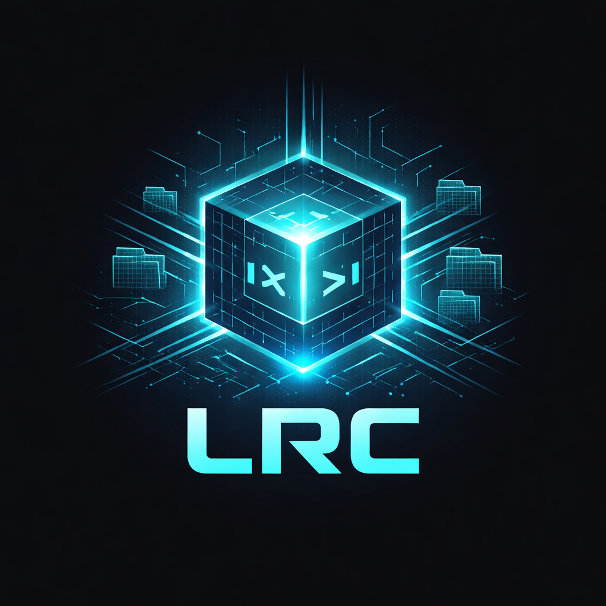

<p align="center">
  
</p>

# LRC — Local Repo Compile

LRC creates, scaffolds and migrates repositories from a declarative spec, deterministically: the same spec
gives the same bytes, the same `plan_id` and (with `@git`) the same initial commit id, on any machine.

- **Plan first.** Every operation compiles to a sorted plan you can inspect (`lrc compile`, `--dry-run`).
- **All or nothing.** `create` builds in a private staging directory, verifies it against the plan, then renames
  it into place. `scaffold` and `migrate` are journaled transactions with automatic rollback, and `lrc rollback`
  undoes the last one later.
- **Collision-proof names.** Case/Unicode collisions, file/directory conflicts, module shadowing (`x.py` beside
  `x/__init__.py`), Windows-reserved names, traversal and escaping symlinks are rejected before anything is
  written. Generated Python packages cannot shadow the standard library.
- **Manifest.** Every repository LRC writes carries `.lrc/manifest.json`, so `lrc validate` can report drift and
  `lrc migrate` can tell LRC's files from yours.
- **`.blux/` generation, BLUX capabilities and DAT handoff.** LRC works standalone with no dependencies. Through
  BLUX it exposes `repo.create`, `repo.scaffold`, `repo.compile`, `repo.migrate` and `repo.validate`, and every
  result names DAT's `repo.audit` as the next step.

## Install

```bash
pipx install outervoid-lrc        # or: pip install outervoid-lrc   (Python 3.11+)
./lrc --help                      # or run from a checkout without installing
```

The PyPI name `lrc` belongs to an unrelated project; the distribution is `outervoid-lrc`, the command is `lrc`.

## Quick start

```text
# Project: Hello Tool
# Description: A small CLI
@template python-cli
@git
docs/
  NOTES.md <<MD
  Notes for ${PROJECT}.
  MD
```

```bash
lrc compile hello.lrc                 # the plan, nothing written
lrc create hello.lrc -o hello-tool    # all or nothing; prints plan id, tree digest and commit
lrc validate hello-tool               # PASS, or the files that drifted
lrc create hello.lrc -o h2 --audit    # also hand the new repository to DAT
lrc migrate hello-v2.lrc -o hello-tool --dry-run
lrc rollback hello-tool               # undo the last scaffold/migrate
lrc templates                         # python-cli, node-cli, rust-cli
```

Exit codes: `0` done, `1` blocked by a check (validation failed, migration conflicts, DAT gate failed; nothing
was changed), `2` usage, `3` failed (rolled back), `4` failed and the rollback failed too.

The LRC 1.x form `lrc schema.lrc [-o DIR] [--dry-run] [--force] [--audit]` still works.

## Documentation

| | |
|---|---|
| [Getting started](docs/getting-started.md) | first repository in five minutes |
| [Usage](docs/USAGE.md) | every command, option and exit code |
| [Spec format](docs/SPEC.md) | `.lrc` text schemas and `lrc.spec` JSON |
| [Templates](docs/TEMPLATES.md) | built-in templates and their variables |
| [Naming](docs/NAMING.md) | what "collision-proof" checks |
| [Engine](docs/ENGINE.md) | create, scaffold, migrate, journal and rollback |
| [Manifest](docs/MANIFEST.md) | `.lrc/manifest.json`, `plan_id` and `tree_digest` |
| [BLUX](docs/BLUX.md) | capabilities, receipts and the LRC → DAT operation chain |
| [DAT](docs/DAT.md) | the audit handoff |
| [Audit of LRC 1.0](docs/AUDIT-1.0.md) | what was wrong and how 2.0 fixes it |
| [Troubleshooting](docs/troubleshooting.md) | common errors |

## Development

```bash
pip install -e '.[dev]'
make ci        # ruff, mypy --strict, pytest, clean-venv wheel check, examples
```

## License

**Outer-Void Proprietary License** (proprietary). Copyright (c) 2026 Outer-Void / Justadudeinspace (JADIS). All rights reserved. See [LICENSE](LICENSE).

Copies and releases obtained before 2026-10-25 remain available under the MIT License they were
published with; every change and release from that date on is proprietary.

Templates never add a licence to the repositories they generate: choosing one is the owner's decision
(DAT reports its absence).

Contact: outervoid.blux@gmail.com (main) · theoutervoid@outlook.com (fallback)
